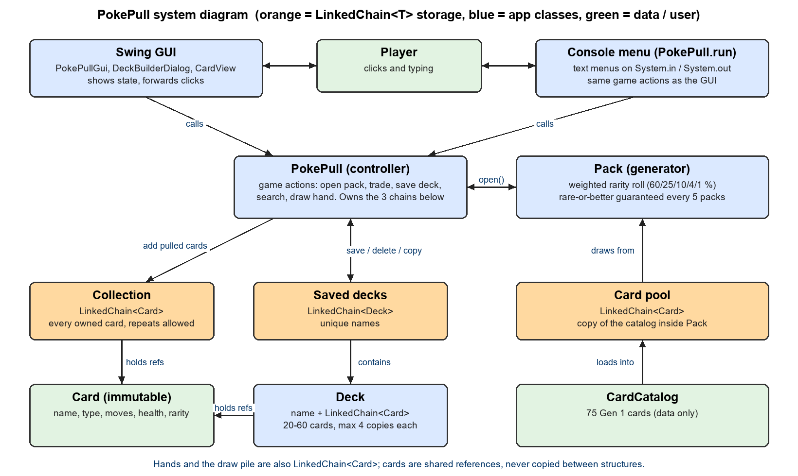

# PokePull (CS 2114 Project 2, Group 94)

PokePull is a deck builder and card collector for Gen 1 Pokémon, written in
Java. A player starts with 10 cards and 2 or 3 packs, opens packs for more
cards (with rarer cards pulled less often), trades cards for packs, builds and
saves decks of 20 to 60 cards, searches their collection, and draws an opening
hand of 7. It can be played in a Swing window or in the console.

All card storage uses one generic class, `LinkedChain<T>` (provided by the
course), holding `Card`, `Deck` and `String` entries.



## Features

- **Card collection** with repeat cards, shown with how many copies you own.
- **Mystery packs** of 8 to 10 cards. Each card's rarity is rolled with
  weights (60% common, 25% uncommon, 10% rare, 4% super rare, 1% legendary),
  and a card of rare or better is guaranteed at least every 5th pack.
- **Trading:** give up 5 cards for 1 pack.
- **Deck building:** decks hold 20 to 60 cards, at most 4 copies of any card,
  and never more copies than you own. Save several decks, copy a deck, or
  delete one.
- **Opening hand:** shuffle a saved deck and draw 7, then keep drawing. The
  saved deck is never changed.
- **Search** your collection by name, type, rarity or move.
- **Card view:** double-click a card in the GUI to see it drawn.

## How to compile and run

You need a JDK, version 17 or newer (we built and tested with Java 21).

### In Eclipse (what we used)

1. File > Import > General > Existing Projects into Workspace, and choose
   this folder.
2. If Eclipse reports a JRE or JUnit problem, open Project > Properties >
   Java Build Path and fix the JRE System Library and JUnit 5 entries.
3. To play in the window, right-click `src/pokepull/PokePullGui.java` and
   choose Run As > Java Application. To play in the console, do the same with
   `PokePull.java`.
4. To run the tests, right-click the `test` folder and choose Run As > JUnit
   Test.

### From the command line

From the project folder:

```bash
mkdir out
javac -d out src/pokepull/*.java
java -cp out pokepull.PokePullGui
```

Use `java -cp out pokepull.PokePull` for the console version. (We checked
these commands with the JDK bundled in Eclipse.)

To run the tests from the command line, download the JUnit Platform Console
Standalone jar from <https://junit.org/junit5/> and run (we ran the tests in
Eclipse, so this command-line form is untested):

```bash
javac -cp junit-platform-console-standalone.jar -d out src/pokepull/*.java test/pokepull/*.java
java -jar junit-platform-console-standalone.jar execute --class-path out --scan-class-path
```

## How to play

**GUI.** Four tabs:

- **Collection:** every card you own. Type in the search box to filter, and
  double-click a card (or press View card) to see it.
- **Packs:** open a pack, or select exactly 5 cards (Ctrl-click) and trade
  them for a pack.
- **Decks:** New deck opens the builder (double-click a card on the left to
  add it, on the right to remove it; Save deck needs at least 20 cards). Copy
  and delete decks here too.
- **Play:** pick a saved deck, draw an opening hand, then draw more cards.

**Console.** Type the menu number: 1 show collection, 2 open a pack, 3 trade,
4 build a deck (type card names, such as `Pikachu 4`, plus `remove <name>`,
`list`, `save` and `cancel`), 5 list decks, 6 copy a deck, 7 delete a deck,
8 draw an opening hand, 9 draw another card, 10 search, 0 quit.

## Project layout

| Folder / file | What it holds |
|---|---|
| `src/pokepull/LinkedChain.java` | The provided generic chain. Storage only. |
| `src/pokepull/Card.java`, `Rarity.java` | One immutable card, and the five rarity tiers. |
| `src/pokepull/Deck.java` | One named deck. Enforces the size and 4-copy rules. |
| `src/pokepull/Pack.java` | Opens a pack: weighted rarity and the rare guarantee. |
| `src/pokepull/CardCatalog.java` | The 75 Gen 1 cards (data only). |
| `src/pokepull/PokePull.java` | The controller: game actions, ownership rules, and the console menu. |
| `src/pokepull/PokePullGui.java`, `DeckBuilderDialog.java`, `CardView.java` | The Swing window, the deck builder, and the card drawing. They only show state and call `PokePull`. |
| `test/pokepull/` | JUnit 5 tests |
| `docs/system-diagram.png` | The system diagram above |

One job per class: `LinkedChain` only stores, the rules live in `Card`,
`Deck`, `Pack` and `PokePull`, and the GUI contains no game rules.

### Where bad input is handled

| Bad input | Where it is caught | What the player sees |
|---|---|---|
| 5th copy of a card, or more copies than owned | `Deck.addCard`, `PokePull.addToDeck` throw `IllegalStateException` | The message in the deck builder; the card is not added. |
| Saving a deck outside 20 to 60 cards | `PokePull.saveDeck` throws | The builder keeps going until the deck is big enough. |
| Blank or duplicate deck name | `Deck` constructor, `PokePull.saveDeck`/`copyDeck` throw | Asked for another name. |
| Deleting a deck that does not exist | `PokePull.deleteDeck` returns false | "No such deck". |
| Drawing from an empty deck, or before starting a hand | `Deck.drawRandom`, `PokePull.drawCard` throw | "The deck is empty" / "Start a hand first". |
| Opening a pack with none left | `PokePull.openPack` throws | "You have no packs to open." (the button is also disabled in the GUI) |
| A rarity with no cards in the pool | `Pack.pickCard` falls back to another tier | The pack is still 8 to 10 cards. |
| Bad trade (wrong count, unowned cards) | `PokePull.tradeForPack` returns false | Message; nothing changes. |
| Bad menu input or end of input | `PokePull.run` | Re-prompts, or exits cleanly. |

## Tests

There are 127 JUnit 5 tests in 10 files in `test/pokepull/`. Every public
method of the app classes has at least one normal and one bad-input test
(getters with no bad input have only a normal test). The tests use seeded
`Random` objects, so they give the same result every run, and the rarity
weights are checked statistically over 1,000 packs.

- Not covered by automatic tests: the two `main` methods, `CardView.show`
  (it opens a modal window), and actually clicking the GUI. We checked those
  by hand and by drawing screens to images.
- `PokePullGuiWindowTest` builds the real windows without showing them. It is
  skipped automatically on a computer with no display.

## Reflection

### What changed from our specification?

- **`LinkedChain` API.** Our spec guessed at the API before we had the real
  class. Three methods we planned (`removeAt`, `copy`, `iterator`) do not
  exist, so we wrote the code against the real API instead.
- **Drawing hands.** The spec had `Deck.openingHand`. We replaced it with
  `Deck.drawCards(n, rng)` on a working copy of the deck, so the opening hand
  and later draws come from the same pile and the saved deck is untouched.
- **Where messages are printed.** The spec had `openPack` and `startHand`
  print messages. They now return values or throw, and only the menu and GUI
  show messages. This keeps console output out of the rules and made them
  testable.
- **Deck size and ownership.** The scope said decks are exactly 60 cards. We
  changed that to 20 to 60 so players can save work in progress, because a new
  player has at most 40 cards. We also limited a deck to the copies the
  player owns (`PokePull.addToDeck`); an earlier build only required owning
  one copy, which let players add cards they did not have.
- **Deck fields.** The spec's `numCards` field was dropped (it is
  `cards.size()`), and a `name` field was added.
- **New classes.** `CardCatalog` (the 75 cards), and the GUI classes
  `PokePullGui`, `DeckBuilderDialog` and `CardView`.
- **Rarity.** We chose rarity as our one reach goal, with five tiers instead of
  a first idea of three. The guarantee is built in by choosing one slot up
  front and making it at least rare, instead of replacing a card afterward.
- **Card-limit exchange.** The scope said to "ask the player if they want to
  exchange cards" at the limit. We refuse the card and tell the player to
  remove another (the GUI shows the message next to the Remove button).
- **Search and card view** were added after the spec at the group's request.

### What changed in the `LinkedChain`?

Nothing except one added line, `package pokepull;`. We use it only through
its public methods: `add`, `addToEnd`, `remove(T)`, `get`, `contains`,
`count`, `size`, `isEmpty`, `clear` and `toArray`. Things the chain does not
offer are built in the app classes: copying a chain reads it with `toArray`
and rebuilds it, and drawing a random card uses `get` then `remove(T)`. The
same class stores `Card` (collection, decks, packs, hands, the card pool),
`Deck` (saved decks) and `String` (the seen-names list when listing the
collection).

### What happened to our unknowns?

- **Weighted draws:** solved. A roll of 0 to 999 is compared against cutoffs,
  one per tier, in `Pack.rollRarity`. The weights are constants.
- **Testing randomness:** solved well enough. `Random` is passed in so tests
  use fixed seeds, the weights are checked statistically, and the guarantee is
  checked by never allowing five packs in a row without a rare-or-better card.
- **Data relationships:** solved. `Card` is immutable, so the collection,
  decks, packs and hands all hold references to the same `Card` objects.
  Nothing is copied, and ownership uses `count` and `contains`.
- **Still open:** whether the weights and the 5-for-1 trade rate feel good in
  real play. We have not playtested them with other people.

### What doesn't work yet or is a known limit?

- No saving: the game resets when it closes.
- The catalog has 75 cards, not all 151, and the moves and HP are not official.
- A deck is not re-checked if you later trade away cards it uses.
- You can trade away any 5 cards, including ones you own only one of.
- The console builder has no "swap a card" prompt, and it cannot show the
  contents of a saved deck (the GUI deck builder can show a draft, but saved
  decks list only their name and size).
- The rare guarantee counter is not saved or reset by New game.
- The `main` methods and actual GUI clicks have no automated tests.

### What we would do next

Add saving to a file, finish the catalog to 151 cards, show a saved deck's
contents, playtest and tune the weights and trade cost, and add an interactive
swap prompt in the console builder.

## Attribution

| File | Who | How |
|---|---|---|
| `LinkedChain.java` | CS 2114 staff | Provided; we only added the package line |
| `Rarity.java` | JC | GenAI-assisted (drafted by Claude) |
| `Card.java` | Hela | GenAI-assisted (drafted by Claude) |
| `Deck.java` | TJ | GenAI-assisted (drafted by Claude) |
| `Pack.java` | Sachin | GenAI-assisted (drafted by Claude) |
| `CardCatalog.java` | Hela | GenAI-assisted (drafted by Claude) |
| `PokePull.java` | JC | GenAI-assisted (drafted by Claude) |
| `PokePullGui.java` | TBD | GenAI-assisted (drafted by Claude) |
| `DeckBuilderDialog.java` | TBD | GenAI-assisted (drafted by Claude) |
| `CardView.java` | TBD | GenAI-assisted (drafted by Claude) |
| `CardTest.java` | Hela | GenAI-assisted (drafted by Claude) |
| `DeckTest.java` | TJ | GenAI-assisted (drafted by Claude) |
| `PackTest.java` | Sachin | GenAI-assisted (drafted by Claude) |
| `PokePullTest.java` | JC | GenAI-assisted (drafted by Claude) |
| `LinkedChainReuseTest.java` | Sachin | GenAI-assisted (drafted by Claude) |
| `LinkedChainTest.java` | TBD | GenAI-assisted (drafted by Claude) |
| `CardCatalogTest.java` | TBD | GenAI-assisted (drafted by Claude) |
| `CardViewTest.java` | TBD | GenAI-assisted (drafted by Claude) |
| `PokePullGuiTest.java` | TBD | GenAI-assisted (drafted by Claude) |
| `PokePullGuiWindowTest.java` | TBD | GenAI-assisted (drafted by Claude) |
| `docs/system-diagram.png` | TBD | GenAI-assisted (drawn by a script written by Claude) |

**How we used GenAI.** We used Claude (Claude Code) throughout. From our
scope document and work-in-progress spec it completed the specification,
wrote the first version of the classes and the tests above, built the Swing
GUI, search and card view, expanded the catalog, drew the system diagram,
compiled and ran the tests, and wrote this README. The team made the design
decisions: the scope itself, choosing rarity as the single reach goal, the
five rarity tiers, the 20 to 60 card deck rule and the ownership limit, the
75-card catalog, and the GUI, search and card-view features. The team ran the
program and the tests in Eclipse and made the commits (including the
attribution edits) shown in the Git history.
